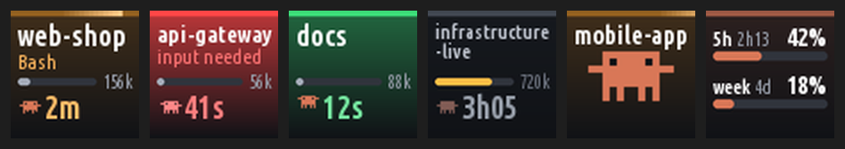

# claude-session-deck

Shows every running [Claude Code](https://claude.com/claude-code) session on an
Elgato Stream Deck: one key per session, with its live state. Pressing a key
jumps to the window that session runs in and, in JetBrains IDEs, to its
terminal tab.



*Rendering with example sessions; the keys are drawn by the daemon's own code.*

> **Work in progress.** This currently only works with the one deck it was
> developed on, an Elgato Stream Deck MK.2 (15 keys, USB ID `0fd9:0080`).
> Other models are not supported.

Not affiliated with Anthropic or Elgato.

## What the keys show

| Part | Meaning |
|---|---|
| Top bar and colour | Session state (see below) |
| Name | Project folder, or the session name if you renamed it |
| Line under the name | While working: the running tool (`Bash`, `Edit`, …) or `thinking`. While waiting: the reason |
| Bar and number | Context used, in tokens, on a 1M scale; amber above 65%, red above 85% |
| Creature and time | How long the session has been in its current state |

| State | Colour | Animation |
|---|---|---|
| Working | Orange | A highlight sweeps along the top bar; every 25 s a large creature appears for 6 s |
| Needs you | Red | The key pulses and the creature waves |
| Done | Green | A slow glow and a jumping creature, until you press the key |
| Idle | Grey | None |

Keys fill left to right, top to bottom, oldest session first. The bottom-right
key is reserved, so up to 14 sessions are shown.

**The usage key** (bottom right) shows the account's 5-hour and weekly usage
limits: percentage used, a bar and the time until reset. It turns amber above
65% and red above 85%. The figures come from Claude Code, so they only update
while a session is active; for accounts without such limits the key reads
`no data yet`.

## Requirements

- Linux with systemd user services
- A Stream Deck MK.2; the original V2 uses the same protocol but is untested
- Python 3.8+ with Pillow
- To jump to windows: a supported desktop, see [Jumping to a window](#jumping-to-a-window)
- Optional: the Ubuntu font; the fallback font is wider, so more text gets shortened

Developed on Ubuntu with GNOME Shell 50 on Wayland and a Stream Deck MK.2;
other setups are untested.

Do not run other Stream Deck software at the same time: claude-session-deck takes over
all keys.

## Install

```sh
git clone https://github.com/schmist/claude-session-deck.git
cd claude-session-deck
./install.sh
```

The script asks before each step that changes the system, and uses `sudo` only
for packages and the udev rule:

- missing packages (Pillow, PyGObject on GNOME, `kdotool` on KDE Wayland)
- the Window Calls extension on GNOME
- a status line command in `~/.claude/settings.json`, for the usage key
- a plugin for each JetBrains IDE found, to select the session's terminal tab
- a udev rule, if the deck is not accessible

`./install.sh --yes` agrees to all of them; without a terminal every question
counts as no. Everything else is installed for the current user only:

| What | Where |
|---|---|
| Daemon | `~/.local/share/claude-session-deck/claude_session_deck.py` |
| Service | `~/.config/systemd/user/claude-session-deck.service` |
| Status line script and its data | `~/.claude/claude-session-deck/` |
| Bundled GNOME extension, if Window Calls is not used | `~/.local/share/gnome-shell/extensions/claude-session-deck-windows@local/` |
| JetBrains plugin | `~/.local/share/JetBrains/<IDE and version>/claude-session-deck/` (Android Studio: under `Google/`) |

To update, pull and run `./install.sh` again. To remove, run `./uninstall.sh`.

**GNOME** needs a shell extension to focus windows. The script offers
[Window Calls](https://extensions.gnome.org/extension/4724/window-calls/), which
loads right away. If you decline, it installs a small bundled extension, which
GNOME only loads at login: log out and back in, then run
`gnome-extensions enable claude-session-deck-windows@local`. Until then, pressing a key
does nothing.

**Device access.** Your user must be allowed to write to the deck's
`/dev/hidraw*` device. Recent distributions grant this; otherwise the script
offers the udev rule. To install it by hand:

```sh
sudo cp udev/70-claude-session-deck.rules /etc/udev/rules.d/
sudo udevadm control --reload
sudo udevadm trigger --subsystem-match=hidraw
```

## How it works

**Session state.** Claude Code keeps one file per running session in
`~/.claude/sessions/<pid>.json` with its name, folder and status. The daemon
reads these four times a second and drops sessions whose process is gone. The
tool name and context size come from the end of the session's transcript in
`~/.claude/projects/`. These files are internal to Claude Code, so an update
can break claude-session-deck.

**Account usage.** Claude Code passes the account's usage limits to its status
line command. The installer registers `statusline.sh` as that command; it
saves the data for the daemon and then runs the status line you had before, if
any. The uninstaller restores the previous setting, and a copy of your earlier
settings is kept in `~/.claude/claude-session-deck/settings.json.before-claude-session-deck`.

**Sessions in sandboxes.** How a session is found depends on what the host
can see of its sandbox:

| Sandbox | What the host sees | How the session is found |
|---|---|---|
| Container that keeps its own `~/.claude` (Docker, Podman, …) | The process, and its files under `/proc/<pid>/root` | The daemon reads the session file and transcript inside the container |
| Container that mounts the host's `~/.claude` | The same, but all such sessions have process ID 1 and so share one session file | The daemon finds the processes itself and derives name and state from each transcript |
| Virtual machine ([Docker Sandboxes](https://docs.docker.com/ai/sandboxes/), `sbx`) | Nothing | A script run inside the sandbox reports its sessions |

A container needs no setup, whatever started it, as long as its `claude`
process runs as your user. For the shared `~/.claude`, deriving the state has
two consequences:

- A permission prompt shows as working, not as needing you; questions and
  plan approvals are recognised.
- A session whose transcript cannot be found reads `no status yet`.

In a virtual machine, the daemon starts a small shell script through the
sandbox's own command (`sbx exec`) in each running sandbox. Once a second it
reports the session files of live sessions and the end of a transcript that
grew; nothing is stored on the host. The script ends when the sandbox has no
session left or the daemon stops, and needs only `sh`, `wc` and `tail` inside.
A sandbox that is stopped is not started.

**The terminal of a sandboxed session.** Such a session has no parent process
on the host that leads to its window. What it reads and writes passes through
a client process in your terminal instead, such as `sbx run` or `docker run`.
The session's terminal inside the sandbox and the client's terminal on the
host were therefore last typed into, and last written to, at the same moments;
the daemon compares these times to tell which client, and so which window and
tab, belongs to which session. This also holds for several sessions in one
sandbox. If no client matches, it takes the latest one started for that
sandbox or project folder.

**Adding a kind of sandbox.** Anything that can run a command inside, such as
`ssh` to another machine, is a subclass of `Sandbox` in
`claude_session_deck.py`, listed in `SANDBOXES`: `running()` returns the names
of the running sandboxes and `command(name)` the start of a command line that
runs its remaining arguments inside one, as `["sbx", "exec", "-i", name]`
does.

**Sessions in the same folder** are labelled with the name Claude gave them;
in a container sharing the host's `~/.claude`, with the session's title.

**The deck.** The daemon writes JPEG images straight to the device and reads
key presses from it, without a Stream Deck library.

## Jumping to a window

Linux has no single way to focus another program's window, so claude-session-deck uses
the first of these mechanisms that sees any windows:

| Desktop | Mechanism | Needs |
|---|---|---|
| GNOME | [Window Calls](https://github.com/ickyicky/window-calls) extension, over D-Bus | GNOME Shell 45+, `python3-gi` |
| GNOME, without Window Calls | Bundled extension, over D-Bus | GNOME Shell 45+, `python3-gi`, one logout and login |
| Sway | `swaymsg` | `SWAYSOCK` visible to the service |
| Hyprland | `hyprctl` | `HYPRLAND_INSTANCE_SIGNATURE` visible to the service |
| KDE Plasma on Wayland | [`kdotool`](https://github.com/jinliu/kdotool) | `kdotool` installed |
| Any X11 window manager | EWMH `_NET_ACTIVE_WINDOW` via libX11 | Nothing extra |

Only GNOME 50 on Wayland with Window Calls and the X11 window listing have
been tested. On other Wayland compositors only XWayland windows can be focused.

If Sway or Hyprland does not pass its environment to the service, add this to
the compositor's startup:

```sh
systemctl --user import-environment SWAYSOCK HYPRLAND_INSTANCE_SIGNATURE WAYLAND_DISPLAY DISPLAY
```

Both GNOME extensions add D-Bus calls that any program running as your user
can use. The bundled one can only list and activate windows; Window Calls, a
third-party project, can also move, resize and close them.

**Which window is chosen:**

1. The window the session's tool reports, if the tool is
   [supported](#tools).
2. The window that had the focus when the session started or last got a
   prompt, if it belongs to the session's terminal or IDE. This is remembered
   in `~/.cache/claude-session-deck/windows.json`.
3. Otherwise a window owned by a parent process of the session, preferring one
   with the project folder name in its title.

Limits, where the session's tool is not supported:

- The window is raised, but the right tab inside it is not selected.
- Until a session gets a prompt while the daemon runs, several windows of one
  program can only be told apart by title, so the wrong one may be raised.
- A session that starts working on its own (a scheduled task, for example) is
  remembered for whichever window of its program has the focus, until your
  next prompt.

## Tools

Raising a window works for any terminal or IDE. For a tool the daemon knows,
it can do more:

| Tool | Extra | Needs |
|---|---|---|
| JetBrains IDEs (IntelliJ IDEA, PyCharm, Android Studio, …) | Selects the session's tab in the Terminal tool window and raises the right project window | The plugin from `jetbrains-plugin/`, the IDE's current terminal (not the Classic one) |

**The JetBrains plugin** is built by `./install.sh` against each IDE it finds
(running, or installed through Toolbox, in `/opt` or as a snap), using the
Java compiler the IDE ships, and is loaded when the IDE next starts. A new
major IDE version has its own plugin directory, so run `./install.sh` again
after such an update. To build it by hand:

```sh
jetbrains-plugin/build.sh <IDE home> <plugins directory>
```

The plugin listens on the socket
`$XDG_RUNTIME_DIR/claude-session-deck/jetbrains-<IDE process ID>.sock`, which
only your user can reach. The daemon sends it the session's parent processes;
the plugin selects the tab whose shell is one of them and replies with the
title of that project's window. It uses the terminal's programming interface,
which JetBrains may change between versions; the key then still raises the
window and the daemon's log says why the tab was not selected.

Developed against IntelliJ IDEA 2026.3; other IDEs are untested. Terminals opened as an editor tab
are not selected.

**Adding a tool.** A tool is a subclass of `Tool` in `claude_session_deck.py`,
listed in `TOOLS`. `runs(pid)` tells whether a process is that tool, and is
asked for each parent process of the session; `focus(pid, chain)` brings the
session to the front inside it and may return the title of its window.

## Configuration

The settings are constants at the top of `claude_session_deck.py`; change them and run
`./install.sh` again.

| Constant | Default | Meaning |
|---|---|---|
| `BRIGHTNESS` | `60` | Key brightness in percent |
| `FPS` | `12` | Frames per second while something is animating |
| `CONTEXT_WINDOW` | `1_000_000` | Token count at which the context bar is full |
| `SAFE_BOTTOM` | `9` | Bottom pixels left empty because the keycap rim hides them |
| `MASCOT_EVERY` | `25` | Seconds between appearances of the large creature |
| `MASCOT_SECONDS` | `6` | How long it stays |
| `MASCOT_ANIMATIONS` | walk 35, think 25, peek 20, wave 20 | Relative probability of each animation |
| `FONT` | Ubuntu variable font | Font file used for all text |

To see how much your keycaps hide, stop the service and run
`python3 claude_session_deck.py --calibrate`. Every key shows nested frames, each
3 pixels wide: white outermost, then red, yellow, green, blue. The outermost
colour visible on a side tells how much is hidden there.

## Troubleshooting

```sh
systemctl --user status claude-session-deck     # is it running?
journalctl --user -u claude-session-deck -f     # log
```

| Symptom | Cause and fix |
|---|---|
| Deck stays dark, log shows `Permission denied` | No access to the device: see Device access under [Install](#install) |
| Deck stays dark, nothing in the log | No supported deck found: check `lsusb` for vendor `0fd9`; only 15-key models are supported |
| Keys flicker or show other content | Another Stream Deck program is running; stop it |
| Pressing a key does nothing, log shows both extensions as `not loaded` | Install Window Calls, or log out and in and run `gnome-extensions enable claude-session-deck-windows@local` |
| Log shows `no window found for …` | The line lists each mechanism tried; none applies to your desktop, or no window matches the session |
| The wrong terminal tab stays selected in a JetBrains IDE | The plugin is not loaded: run `./install.sh`, then restart the IDE. If the log shows `JetBrains IDE: cannot focus …`, see the IDE's own log (Help → Show Log) |
| Usage key reads `no data yet` | The status line command is not set up (run `./install.sh` again), no session has been active since, or the account has no usage limits |
| A session is missing | It is not interactive, or it runs in a sandbox the daemon cannot look into: a container whose process is not yours, or a [kind of sandbox](#how-it-works) it does not know |
